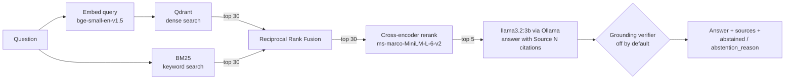

# RAGForge

A retrieval-augmented generation (RAG) service that answers questions about documents with cited sources, built to be **measured**, not demoed. It runs fully locally: Qdrant for vectors, BM25 for keywords, a cross-encoder reranker, and a 3B-parameter model through Ollama.

Every design decision below comes with the experiment that justified it, including two features that were removed or turned off because the evaluation showed they hurt.


## Contents

- [Architecture](#architecture)
- [Results](#results)
- [What the experiments decided](#what-the-experiments-decided)
- [How answers are evaluated](#how-answers-are-evaluated)
- [Known failures and limitations](#known-failures-and-limitations)
- [API](#api)
- [Running it](#running-it)
- [Project layout](#project-layout)
- [Security and data](#security-and-data)

## Architecture



**Ingestion:** PDF → text cleaning → section-aware chunking (numbered legal sections are kept whole when they fit in 1,000 characters, otherwise split with 150 characters of overlap) → embeddings → Qdrant. The document ID is a hash of the file's contents, so re-indexing the same file from any path replaces its chunks instead of duplicating them.

**Abstention is a field, not a phrase.** `/query` returns `abstained` and `abstention_reason` (`no_results`, `model_abstained` or `failed_verification`), so clients and the evaluation never guess from the answer's wording.

## Results

Evaluation set: one 4-page residential lease (27 chunks), **35 hand-labeled questions**: 28 answerable, 7 deliberately unanswerable. Each question is tagged with the failure mode it probes (paraphrase, vocabulary gap, multi-clause, calculation, distractor, …). All numbers are single runs on an Apple M1 MacBook Air; with 28 questions, **one question is about 0.036 of any rate**, so small differences are noise.

The numbers below were measured on the original lease, before its names and address were replaced with fictional ones (see [Security and data](#security-and-data)). That replacement changed 2 of the 27 chunks, neither of which holds evaluation evidence.

### Retrieval (no LLM involved; candidate pool 10)

| Strategy | Hit@1 | Hit@5 | MRR | nDCG@5 | Coverage@5 | ms/query |
|---|---:|---:|---:|---:|---:|---:|
| Dense (Qdrant) | 0.86 | 1.00 | 0.92 | 0.93 | 0.99 | 13 |
| BM25 | 0.71 | 0.93 | 0.80 | 0.82 | 0.93 | <1 |
| Hybrid (RRF) | 0.89 | 1.00 | 0.94 | 0.94 | 0.99 | 9 |
| **Hybrid + rerank** (production) | **0.93** | **1.00** | **0.96** | **0.96** | **0.99** | **95** |

*Coverage@5* is the share of a question's required evidence found in the top 5 chunks, the metric that matters for multi-part questions. BM25 alone is weakest on paraphrase (0.71) and vocabulary-gap (0.75) questions, as expected for keyword matching. Reranking adds one question at rank 1 over plain hybrid, which is within noise, at about 10× the latency.

### Answers (production path: retrieval → generation, verifier off)

| Metric | llama3.2:3b |
|---|---:|
| Mean fact recall (answerable) | **0.905** |
| Complete answers | 23 / 28 |
| Wrong yes/no (contradicted) | 0 / 28 |
| False refusals | 1 / 28 |
| Correct refusals (unanswerable) | 6 / 7 |
| Citations pointing to a real source | 35 / 35 |
| Cited chunk contains the evidence | 24 / 24 |
| Answerable questions with no citation | 4 / 28 |
| Generation time, mean | 7.1 s |
| Retrieval time, mean (incl. rerank) | 0.95 s |

Source: [`data/eval/runs/clean-v2-3b-reindexed-rescored.json`](data/eval/runs/clean-v2-3b-reindexed-rescored.json).

## What the experiments decided

Each change was evaluated against the previous configuration with one variable changed, and the decision rule was written down before the run.

| Change | Result | Decision |
|---|---|---|
| **Removed test leakage from prompts.** The original system prompt contained the answer to an eval question (the late-fee calculation); the grounding verifier's prompt contained another question's evidence clause and two exact model answers. | A rule written for one question makes that question's score meaningless. | Removed. [`tests/test_prompt_leakage.py`](tests/test_prompt_leakage.py) fails if any eval question, evidence or answer appears in a prompt; it caught one more case on its first run. |
| **General prompt** replacing the rule-patched prompt | Fact recall 0.781 → 0.829; uncited answers 10 → 2 | Adopted |
| **"No hedging" prompt (clean-v2)** | "Answered but also said info was missing" 19 → 6 of 28; generation time −34%; recall 0.829 → 0.858 (noise); uncited answers 2 → 6 | Adopted, with the citation cost noted |
| **LLM grounding verifier** (second model call checks each answer) | Recall 0.829 → **0.250**: blocked 18 complete and 3 partial answers to catch 1 hallucination; +10 s per answer | **Off by default** (`GROUNDING_VERIFIER_ENABLED=false`); kept behind a flag, with per-check diagnostics, for re-testing with a stronger judge model |
| **Rebuilt the index** with the current chunker | A clause split across a page break became retrievable as one unit: the utilities question went 0.20 → 1.00 | Adopted; the planned page-break fix was dropped as unnecessary |
| **Larger model (llama3.1:8b)** | Ran out of GPU memory on an 8 GB M1; outputs were corrupted | Not measurable on this hardware; stayed on llama3.2:3b |

Run files for these comparisons are in [`data/eval/runs/`](data/eval/runs/), and `answer_eval.py --compare A.json B.json` reproduces each question-by-question diff.

## How answers are evaluated

There is no LLM judge. [`answer_checks.py`](src/ragforge/evaluation/answer_checks.py) scores answers deterministically:

- **Fact recall.** Each answerable question has `answer_facts`: groups of acceptable phrasings (for example `["14 days", "fourteen days", "fourteen (14) days"]`). An answer earns a group when it contains any phrasing as a whole word. Recall is the share of groups found.
- **Contradiction.** `answer_must_not` lists wrong-polarity phrasings (for example "does not have to give notice"). If one appears, the answer scores zero, even if it also contains the right words.
- **Refusals** are detected per sentence: a "missing information" pattern plus a reference to the context ("not available in the provided documents"). A *correct refusal* must **lead** with the refusal, so an answer that states a made-up fact and then hedges does not count.
- **Citations.** `[Source N]` references are parsed (including "Sources 1, 2 and 5"), checked for range, and checked for whether the cited chunk contains the question's evidence.

**Guards on the evaluation itself** ([`tests/test_answer_checks.py`](tests/test_answer_checks.py)): every question's reference answer must satisfy its own fact groups; no fact group may be satisfied by repeating the question back; a bare refusal must score zero. Every label change made after seeing model output is recorded in that question's `label_note`, with the reason. `--rescore` re-applies the current scorer to saved answers without re-running the model.

**Known limits of the scorer:** phrase matching is lexical, so "seven days" and "a week" are different unless both are listed; wrong-polarity phrasings are only caught once someone adds them to `answer_must_not`; refusal patterns are a fixed list.

## Known failures and limitations

Remaining failures in the baseline run, by cause:

- **Model capability (3B):** refuses the late-fee calculation it has the facts for (q06); invents "quiet hours" from the landlord's entry hours (q35); sometimes drops the second clause of a multi-part answer (q21, q25).
- **Retrieval:** the "last 60 days" entry clause ranks outside the top 5 for "all conditions under which the landlord can enter" (q04); widening the candidate pool did not fix it.
- **Chunker:** the heading "12. FIRE SAFETY and HAZARDOUS MATERIALS." is not recognized because of the lowercase "and", so section 12 is labeled as part of section 11.
- **Operational:** BM25 is built in memory from the indexed chunks; after re-indexing, restart the API so it rebuilds.

**Scope:** one 4-page document and 35 questions. That is enough to catch regressions and large effects, not to claim small differences; the next step for the evaluation is a second document and more multi-clause and vocabulary-gap questions.

## API

### `POST /query`

```bash
curl -s localhost:8000/query -H 'content-type: application/json' \
  -d '{"query": "How many days does the landlord have to return the deposit?", "top_k": 5}'
```

Response shape:

```json
{
  "query": "How many days does the landlord have to return the deposit?",
  "answer": "… within fourteen (14) days after the Tenant vacates [Source 1].",
  "sources": [{"citation": "[Source 1]", "page": "3", "section": "19", "text": "…"}],
  "abstained": false,
  "abstention_reason": null
}
```

| Status | When |
|---|---|
| 200 | Answer or abstention; check `abstained` |
| 422 | Empty query, or `top_k` outside 1–10 |
| 503 | Qdrant or Ollama unreachable, or nothing indexed (safe to retry) |
| 502 | Unexpected failure during retrieval or generation |

### `GET /health`

Returns `200` with `"status": "healthy"` when PostgreSQL, Redis and Qdrant respond, otherwise `503` with each one marked `"ok"` or `"down"`. Error details go to the server log, never to the response. The API starts even when a service is down and reconnects to Qdrant when it comes back.

## Running it

Requirements: Python 3.13, [uv](https://docs.astral.sh/uv/), Docker, [Ollama](https://ollama.com).

```bash
cp .env.example .env
docker compose up -d postgres redis qdrant
uv sync --frozen
ollama pull llama3.2:3b
uv run python -m ragforge.vector.reindex data/test.pdf
uv run uvicorn ragforge.app.main:app --port 8000
```

### Tests

```bash
uv run pytest -q
```

All tests run offline, without Docker, Ollama or model downloads. The same suite runs in [GitHub Actions](.github/workflows/tests.yml) on every push.

### Evaluations (need Qdrant and Ollama)

```bash
uv run python tests/evaluation/retrieval_eval.py
uv run python tests/evaluation/answer_eval.py --json data/eval/runs/my-run.json
uv run python tests/evaluation/answer_eval.py --compare data/eval/runs/A.json data/eval/runs/B.json
```

`answer_eval.py` options: `--model`, `--prompt {clean,clean-v2}`, `--verifier {on,off}`, `--top-k`, `--num-ctx`, `--only q04 q06`, `--verbose`, `--rescore RUN.json`. A full run takes about 5 minutes on an M1 MacBook Air.

### Configuration

Settings come from environment variables or `.env` (see [`.env.example`](.env.example)). Notable ones: `OLLAMA_MODEL` (default `llama3.2:3b`), `QDRANT_COLLECTION`, and `GROUNDING_VERIFIER_ENABLED` (default `false`, see above). The embedding model and vector size must match the Qdrant collection; changing the embedding model means re-indexing into a new collection.

## Project layout

```
src/ragforge/
  app/
    main.py              FastAPI app: /query, /health, degraded-mode startup
    generation/          prompts, Ollama client, answer_query(), grounding verifier
    retrieval/           Qdrant search, BM25, RRF fusion, reranker
    models/query.py      request/response schemas
  ingestion/             PDF loading, cleaning, section-aware chunking, embeddings
  evaluation/            retrieval metrics and deterministic answer checks
  vector/reindex.py      index or re-index one document
tests/                   offline unit tests (run in CI)
tests/evaluation/        live retrieval and answer evaluations
data/eval/lease_eval.json  35 labeled questions
data/eval/runs/          saved evaluation runs behind the numbers above
```

## Security and data

- `data/test.pdf` is a real lease form with **fictional names and address**; rent, dates and clauses are unchanged so the labeled questions stay valid.
- Never commit `.env`, API keys or private documents. `.env.example` holds local development defaults only.
- Not yet implemented: authentication, rate limiting and request tracing. Do not expose this service publicly as-is.
