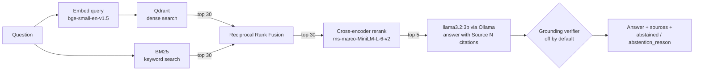

# RAGForge

A retrieval-augmented generation (RAG) service that answers questions about documents with cited sources, built to be **measured**, not demoed. It runs fully locally: Qdrant for vectors, BM25 for keywords, a cross-encoder reranker, and a 3B-parameter model through Ollama.

Every design decision below comes with the experiment that justified it, including two features that were removed or turned off because the evaluation showed they hurt.


## Contents

- [Architecture](#architecture)
- [Results](#results)
- [What the experiments decided](#what-the-experiments-decided)
- [How answers are evaluated](#how-answers-are-evaluated)
- [Known failures and limitations](#known-failures-and-limitations)
- [API](#api)
- [Running it](#running-it)
- [Project layout](#project-layout)
- [Security and data](#security-and-data)

## Architecture



**Ingestion:** PDF → text cleaning → pages joined → section-aware chunking (numbered legal sections are kept whole when they fit in 1,000 characters, otherwise split with 150 characters of overlap; each chunk records its start and end page) → embeddings → Qdrant. Joining pages first keeps a clause that continues onto the next page in one chunk. The document ID is a hash of the file's contents, so re-indexing the same file from any path replaces its chunks instead of duplicating them.

**Abstention is a field, not a phrase.** `/query` returns `abstained` and `abstention_reason` (`no_results`, `model_abstained` or `failed_verification`), so clients and the evaluation never guess from the answer's wording.

**API layer:** every request passes through a request-ID middleware that writes one JSON log line per request. Protected endpoints then check the API key (`X-API-Key`, stored only as SHA-256 hashes) and a per-key rate limit in Redis. `/query` checks a Redis answer cache, keyed by a hash of the normalized question and invalidated whenever the indexed content changes. Redis problems never take the API down: rate limiting and caching fail open, with a warning in the log.

## Results

Evaluation set: one 4-page residential lease (28 chunks), **35 hand-labeled questions**: 28 answerable, 7 deliberately unanswerable. Each question is tagged with the failure mode it probes (paraphrase, vocabulary gap, multi-clause, calculation, distractor, …). All numbers are single runs on an Apple M1 MacBook Air; with 28 questions, **one question is about 0.036 of any rate**, so small differences are noise.

### Retrieval (no LLM involved; candidate pool 10)

Measured on the shipped document. Run it with `uv run python tests/evaluation/retrieval_eval.py`.

| Strategy | Hit@1 | Hit@5 | MRR | nDCG@5 | Coverage@5 | ms/query |
|---|---:|---:|---:|---:|---:|---:|
| Dense (Qdrant) | 0.82 | 1.00 | 0.90 | 0.92 | 0.99 | 12 |
| BM25 | 0.71 | 0.93 | 0.81 | 0.81 | 0.93 | <1 |
| Hybrid (RRF) | 0.93 | 1.00 | 0.96 | 0.95 | 0.99 | 9 |
| **Hybrid + rerank** (production) | **0.93** | **1.00** | **0.96** | **0.95** | **0.99** | **88** |

*Coverage@5* is the share of a question's required evidence found in the top 5 chunks, the metric that matters for multi-part questions. BM25 alone is weakest on paraphrase (0.71) and vocabulary-gap (0.75) questions, as expected for keyword matching. Hybrid beats either retriever alone. Reranking shows no measurable gain over plain hybrid on this 28-chunk document, at about 10× the latency; it stays in the pipeline because it is expected to matter more on larger corpora, which this evaluation cannot yet show.

### Answers (production path: retrieval → generation, verifier off)

| Metric | llama3.2:3b |
|---|---:|
| Mean fact recall (answerable) | **0.826** |
| Complete answers | 19 / 28 |
| Wrong yes/no (contradicted) | 0 / 28 |
| False refusals | 1 / 28 |
| Correct refusals (unanswerable) | 6 / 7 |
| Citations pointing to a real source | 35 / 35 |
| Cited chunk contains the evidence | 23 / 24 |
| Answerable questions with no citation | 4 / 28 |
| Generation time, mean | 6.9 s |
| Retrieval time, mean (incl. rerank) | 1.8 s |

Source: [`data/eval/runs/clean-v2-3b-chunking-v2.json`](data/eval/runs/clean-v2-3b-chunking-v2.json). Generation is deterministic at temperature 0: three repeated runs of the previous configuration produced identical answers and scores ([1](data/eval/runs/clean-v2-3b-sample-lease.json), [2](data/eval/runs/clean-v2-3b-sample-lease-2.json), [3](data/eval/runs/clean-v2-3b-sample-lease-3.json)); only timings vary, with machine load.

## What the experiments decided

Each change was evaluated against the previous configuration with one variable changed, and the decision rule was written down before the run.

| Change | Result | Decision |
|---|---|---|
| **Removed test leakage from prompts.** The original system prompt contained the answer to an eval question (the late-fee calculation); the grounding verifier's prompt contained another question's evidence clause and two exact model answers. | A rule written for one question makes that question's score meaningless. | Removed. [`tests/test_prompt_leakage.py`](tests/test_prompt_leakage.py) fails if any eval question, evidence or answer appears in a prompt; it caught one more case on its first run. |
| **General prompt** replacing the rule-patched prompt | Fact recall 0.781 → 0.829; uncited answers 10 → 2 | Adopted |
| **"No hedging" prompt (clean-v2)** | "Answered but also said info was missing" 19 → 6 of 28; generation time −34%; recall 0.829 → 0.858 (noise); uncited answers 2 → 6 | Adopted, with the citation cost noted |
| **LLM grounding verifier** (second model call checks each answer) | Recall 0.829 → **0.250**: blocked 18 complete and 3 partial answers to catch 1 hallucination; +10 s per answer | **Off by default** (`GROUNDING_VERIFIER_ENABLED=false`); kept behind a flag, with per-check diagnostics, for re-testing with a stronger judge model |
| **Sensitivity check:** same configuration, source text differing only in stray spaces from PDF extraction ("th e" → "the") | Two answers changed: utilities (q05) 1.00 → 0.20, renter's insurance (q22) 1.00 → 0.50; fact recall 0.905 → 0.858. Three repeat runs were identical. | The 3B model is deterministic but sensitive to trivial input changes, so differences of 1–2 questions are treated as noise. q05's fragility was traced to a chunking defect, fixed next. |
| **Chunking fix:** recognize all numbered headings (two were missed: one with a lowercase "and", one without a trailing period), join pages before splitting into sections, keep a sentence fragment the old code dropped | Retrieval unchanged within noise (rerank Hit@1 0.93, MRR 0.96). Utilities (q05) 0.20 → 0.80, now one chunk instead of two. q28 1.00 → 0.50 and q30 1.00 → 0.00; recall 0.858 → 0.826, about one question | Adopted: it fixes lost and mislabeled text, and fixes the targeted question by the expected mechanism. The two regressions are the model choosing the wrong retrieved clause (q30's evidence was retrieved and cited). |
| **Larger model (llama3.1:8b)** | Ran out of GPU memory on an 8 GB M1; outputs were corrupted | Not measurable on this hardware; stayed on llama3.2:3b |

Run files for these comparisons are in [`data/eval/runs/`](data/eval/runs/), and `answer_eval.py --compare A.json B.json` reproduces each question-by-question diff.

## How answers are evaluated

There is no LLM judge. [`answer_checks.py`](src/ragforge/evaluation/answer_checks.py) scores answers deterministically:

- **Fact recall.** Each answerable question has `answer_facts`: groups of acceptable phrasings (for example `["14 days", "fourteen days", "fourteen (14) days"]`). An answer earns a group when it contains any phrasing as a whole word. Recall is the share of groups found.
- **Contradiction.** `answer_must_not` lists wrong-polarity phrasings (for example "does not have to give notice"). If one appears, the answer scores zero, even if it also contains the right words.
- **Refusals** are detected per sentence: a "missing information" pattern plus a reference to the context ("not available in the provided documents"). A *correct refusal* must **lead** with the refusal, so an answer that states a made-up fact and then hedges does not count.
- **Citations.** `[Source N]` references are parsed (including "Sources 1, 2 and 5"), checked for range, and checked for whether the cited chunk contains the question's evidence.

**Guards on the evaluation itself** ([`tests/test_answer_checks.py`](tests/test_answer_checks.py)): every question's reference answer must satisfy its own fact groups; no fact group may be satisfied by repeating the question back; a bare refusal must score zero. Every label change made after seeing model output is recorded in that question's `label_note`, with the reason. `--rescore` re-applies the current scorer to saved answers without re-running the model.

**Known limits of the scorer:** phrase matching is lexical, so "seven days" and "a week" are different unless both are listed; wrong-polarity phrasings are only caught once someone adds them to `answer_must_not`; refusal patterns are a fixed list.

## Known failures and limitations

Remaining failures in the baseline run, by cause:

- **Model capability (3B):** refuses the late-fee calculation it has the facts for (q06); invents "quiet hours" from the landlord's entry hours (q35); answers the move-out question from the move-in clause although the move-out clause was retrieved and cited (q30); drops part of some multi-part answers (q05's $60 charge, q21, q22, q25, q28's late fee).
- **Retrieval:** the "last 60 days" entry clause ranks outside the top 5 for "all conditions under which the landlord can enter" (q04); widening the candidate pool did not fix it.
- **Operational:** indexing an upload runs inside the request (about 2 s for this document; large files would need a background job). The rate limit uses fixed one-minute windows, so a client can burst up to twice the limit across a window boundary. If Redis is down, requests are served without rate limiting or caching, and running API workers notice re-indexing only once Redis is back.

**Scope:** the numbers above are one 4-page document and 35 questions. That is enough to catch regressions and large effects, not to claim small differences.

### Second document

[`data/remote_work_policy.md`](data/remote_work_policy.md) is a 13-section workplace policy written for this evaluation, in a different domain and style from the lease, with [32 labeled questions](data/eval/policy_eval.json) (27 answerable, 5 unanswerable). It is designed to probe what the lease couldn't:

- **Two documents in one index.** With both indexed, every lease question also competes with policy chunks, and the two `cross-doc` questions ask about notice periods, which both documents have. The lease numbers above were measured with the lease alone.
- **Near-duplicate numbers.** 14 days appears four times (equipment return, travel booking, return-to-office notice) and 30 or 60 days twice, so `distractor` questions need the right clause, not just the right number.
- **A fact outside every section.** The effective date sits in the title block before section 1. The chunker used to drop a title block shorter than 200 characters, so p27 was unanswerable by construction; a short title block is now joined to the first section instead. The lease's chunks are byte-for-byte unchanged by this fix, so its results above still hold.

Results for this set: not run yet (needs Qdrant and Ollama).

## API

Interactive documentation is served at `/docs`. All endpoints except `/` and `/health` need an API key:

```bash
uv run python -m ragforge.app.security new-key
```

This prints a key (give it to the client) and its SHA-256 hash (add it to `API_KEY_HASHES` in `.env`; several keys are comma-separated). Only hashes are stored, and logs identify callers by a `key_id` derived from the hash, never by the key itself.

| Endpoint | Purpose |
|---|---|
| `POST /query` | Answer a question with cited sources |
| `POST /documents` | Upload a PDF, `.txt` or `.md` file (max 10 MB) and index it; the same file name replaces the earlier version |
| `GET /documents` | List indexed documents with chunk and page counts |
| `DELETE /documents/{document_id}` | Remove a document from the index (and its uploaded file) |
| `GET /health` | Readiness: PostgreSQL, Redis and Qdrant |

### `POST /query`

```bash
curl -s localhost:8000/query -H "X-API-Key: $RAGFORGE_KEY" -H 'content-type: application/json' \
  -d '{"query": "How many days does the landlord have to return the deposit?", "top_k": 5}'
```

Response shape:

```json
{
  "query": "How many days does the landlord have to return the deposit?",
  "answer": "… within fourteen (14) days after the Tenant vacates [Source 1].",
  "sources": [{"citation": "[Source 1]", "page": "3", "section": "19", "text": "…"}],
  "abstained": false,
  "abstention_reason": null,
  "cached": false
}
```

### `POST /documents`

```bash
curl -s localhost:8000/documents -H "X-API-Key: $RAGFORGE_KEY" -F file=@data/test.pdf
```

The file is checked (type, size, PDF signature, extractable text) before anything is indexed. If indexing fails, the previous version of the file is restored, so the stored file always matches the index.

### Status codes

| Status | When |
|---|---|
| 200 / 201 | Success. For `/query`, check `abstained` |
| 401 | Missing or invalid API key |
| 404 | `DELETE` of an unknown document |
| 413 | Upload larger than `MAX_UPLOAD_MB` |
| 415 | Unsupported file type, or not really a PDF |
| 422 | Invalid request, or no text could be extracted from the upload |
| 429 | Rate limit exceeded; wait `Retry-After` seconds |
| 503 | Qdrant or Ollama unreachable, nothing indexed, or authentication not configured (safe to retry) |
| 502 | Unexpected failure during retrieval or generation |

Every response carries `X-Request-ID` (send your own to correlate calls across services), and protected endpoints add `X-RateLimit-Limit`, `X-RateLimit-Remaining` and `X-RateLimit-Reset`.

### `GET /health`

Returns `200` with `"status": "healthy"` when PostgreSQL, Redis and Qdrant respond, otherwise `503` with each one marked `"ok"` or `"down"`. Error details go to the server log, never to the response. The API starts even when a service is down and reconnects to Qdrant when it comes back.

### Logs

One JSON object per line on stdout, including uvicorn's own messages. Each request produces a line like:

```json
{"ts": "2026-10-10T18:07:35.890Z", "level": "INFO", "logger": "ragforge.access", "msg": "request",
 "request_id": "6631fa17…", "method": "POST", "path": "/query", "status": 200, "latency_ms": 6890.4,
 "key_id": "key_263ba912ffcc", "top_k": 5, "query_chars": 61, "cache": "miss",
 "abstained": false, "abstention_reason": null, "retrieval_ms": 812.0, "generation_ms": 6011.3}
```

The question text is never logged, since questions can contain personal data; a test fails if any log call includes it.

## Running it

Requirements: Docker, [Ollama](https://ollama.com) running on the host (it uses the host's GPU), and for local development Python 3.13 with [uv](https://docs.astral.sh/uv/).

```bash
cp .env.example .env
ollama pull llama3.2:3b
uv run python -m ragforge.app.security new-key   # put the printed hash in API_KEY_HASHES in .env
```

### With Docker (everything except Ollama)

```bash
docker compose up -d --build
docker compose ps                                 # wait until ragforge-api is "healthy"
export RAGFORGE_KEY=rf_...                        # the key printed above
curl -s localhost:8000/documents -H "X-API-Key: $RAGFORGE_KEY" -F file=@data/test.pdf
```

The API container reaches Ollama on the host through `host.docker.internal`. The first query or upload downloads the embedding and reranking models (a few hundred MB) into a volume, so later starts are fast. Uploaded files are kept in the `uploads` volume.

### Locally

```bash
docker compose up -d postgres redis qdrant
uv sync --frozen
uv run python -m ragforge.vector.reindex data/test.pdf
uv run uvicorn ragforge.app.main:app --port 8000
```

### Tests

```bash
uv run pytest -q
```

All tests run offline, without Docker, Ollama or model downloads. The same suite runs in [GitHub Actions](.github/workflows/tests.yml) on every push. One opt-in end-to-end test, [`tests/test_integration.py`](tests/test_integration.py), calls the live stack; run it with `RAGFORGE_RUN_INTEGRATION=1 uv run pytest -q tests/test_integration.py`.

### Evaluations (need Qdrant and Ollama)

```bash
uv run python tests/evaluation/retrieval_eval.py
uv run python tests/evaluation/answer_eval.py --json data/eval/runs/my-run.json

# second document: index it next to the lease, then run each set
uv run python -m ragforge.vector.reindex data/remote_work_policy.md
uv run python tests/evaluation/retrieval_eval.py --dataset data/eval/policy_eval.json
uv run python tests/evaluation/answer_eval.py --dataset data/eval/policy_eval.json --json data/eval/runs/policy-3b.json
uv run python tests/evaluation/answer_eval.py --compare data/eval/runs/A.json data/eval/runs/B.json
```

`answer_eval.py` options: `--model`, `--prompt {clean,clean-v2}`, `--verifier {on,off}`, `--top-k`, `--num-ctx`, `--only q04 q06`, `--verbose`, `--rescore RUN.json`. A full run takes about 5 minutes on an M1 MacBook Air.

### Configuration

Settings come from environment variables or `.env` (see [`.env.example`](.env.example)):

| Setting | Default | Meaning |
|---|---|---|
| `API_KEY_HASHES` | *(empty)* | Comma-separated SHA-256 hashes of valid keys. Empty means protected endpoints return 503 |
| `AUTH_ENABLED` | `true` | `false` disables authentication (local development only) |
| `RATE_LIMIT_PER_MINUTE` | `30` | Requests per key per minute; `0` disables |
| `ANSWER_CACHE_TTL_SECONDS` | `3600` | How long answers are cached; `0` disables |
| `MAX_UPLOAD_MB` / `UPLOAD_DIR` | `10` / `data/uploads` | Upload size limit and storage folder |
| `LOG_FORMAT` / `LOG_LEVEL` | `json` / `INFO` | `text` for human-readable logs |
| `OLLAMA_MODEL` | `llama3.2:3b` | Generation model |
| `GROUNDING_VERIFIER_ENABLED` | `false` | See the verifier experiment above |

The embedding model and vector size must match the Qdrant collection; changing the embedding model means re-indexing into a new collection.

## Project layout

```
src/ragforge/
  app/
    main.py              FastAPI app: /query, /health, degraded-mode startup, answer cache
    documents.py         /documents upload, list and delete
    security.py          API keys (hashing, verification, key generation)
    rate_limit.py        per-key Redis rate limit
    middleware.py        request IDs and structured access logs
    cache/answers.py     answer cache and corpus version
    generation/          prompts, Ollama client, answer_query(), grounding verifier
    retrieval/           Qdrant search, BM25, RRF fusion, reranker
    models/query.py      request/response schemas
  ingestion/             PDF loading, cleaning, section-aware chunking, embeddings
  evaluation/            retrieval metrics and deterministic answer checks
  vector/reindex.py      index or re-index one document
tests/                   offline unit tests (run in CI)
tests/evaluation/        live retrieval and answer evaluations
data/eval/lease_eval.json  35 labeled questions on the lease
data/eval/policy_eval.json 32 labeled questions on the remote work policy
data/eval/runs/          saved evaluation runs behind the numbers above
```

## Security and data

- `data/test.pdf` is a real lease form with **fictional names and address**; rent, dates and clauses are unchanged so the labeled questions stay valid.
- `data/remote_work_policy.md` describes a fictional company and was written for the evaluation.
- Never commit `.env`, API keys or private documents. `.env.example` holds local development defaults only.
- API keys are stored only as hashes and compared in constant time. Without configured keys the API fails closed.
- Uploads are limited in size and type, stored under a sanitized name inside `UPLOAD_DIR`, and never executed.
- Not included: TLS (terminate it at a reverse proxy), key rotation beyond editing `API_KEY_HASHES`, and per-key permissions. Put it behind a reverse proxy before exposing it to the internet.
